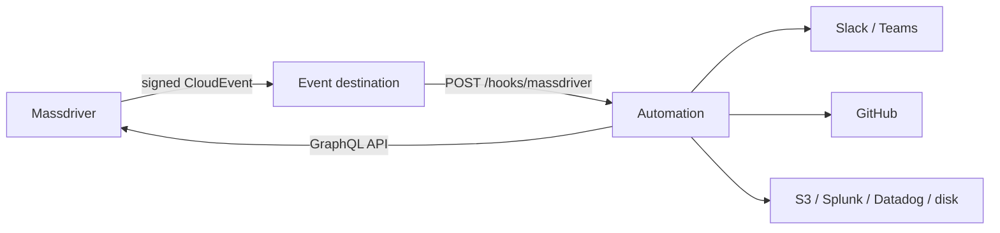

<div align="center">

# massdriver-automations

**Event-driven automations for [Massdriver](https://www.massdriver.cloud).**
Deploy downstream on upstream changes, catch drift, freeze prod, approve from Slack, archive every event.

[](https://github.com/massdriver-cloud/massdriver-automations/actions/workflows/ci.yml)
[](https://github.com/massdriver-cloud/massdriver-automations/actions/workflows/publish.yml)
[](https://github.com/massdriver-cloud/massdriver-automations/releases)
[](https://pkg.go.dev/github.com/massdriver-cloud/massdriver-automations)
[](https://goreportcard.com/report/github.com/massdriver-cloud/massdriver-automations)
[](LICENSE)

[Automations](#automations) ·
[Quick start](#quick-start) ·
[Deploy](#deploy) ·
[Write your own](#write-an-automation) ·
[Event destinations docs](https://docs.massdriver.cloud/platform-operations/event-destinations)

</div>

---

Massdriver sends an event for every change in your organization: deployments, instances, alarms, bundle versions,
groups, and more. An [event destination](https://docs.massdriver.cloud/platform-operations/event-destinations)
posts those events to an HTTP endpoint, signed with [Standard Webhooks](https://www.standardwebhooks.com).

This repository is a set of small services that receive those events and act on them. They ship as one image,
one automation per container, and two Massdriver bundles run any set of them on Kubernetes or Amazon ECS.



## Automations

| Automation | Events | Does |
|---|---|---|
| [autodeploy-downstream](automations/autodeploy-downstream) | `deployment.completed` | Deploys opted-in dependents when an instance deploys. |
| [rollback-on-failure](automations/rollback-on-failure) | `deployment.failed` | Rolls an opted-in instance back to its last completed deployment when a deployment fails. |
| [drift](automations/drift) | `deployment.completed`, `deployment.failed`, `deployment.aborted` | Plans instances on a schedule, alerts Slack about drift, and can re-apply the deployed configuration. |
| [freeze-guard](automations/freeze-guard) | `group.created`, `group.updated`, `group.deleted` | Adds deny policies for deployment actions to groups during change freeze windows. |
| [proposal-chatops](automations/proposal-chatops) | `deployment.proposed`, `deployment.approved`, `deployment.rejected` | Approve or reject proposed deployments from Slack. |
| [github-deployments](automations/github-deployments) | `deployment.*` | Shows Massdriver deployments as GitHub Deployments. |
| [release-notes](automations/release-notes) | `repo.published` | Posts new bundle versions, and the instances that can upgrade, to Slack and Teams. |
| [bundle-scanner](automations/bundle-scanner) | `repo.published` | Scans each new bundle version with Trivy and Checkov. Uses the `-scanner` image tag. |
| [sandbox-on-join](automations/sandbox-on-join) | `group_membership.*`, `deployment.completed` | Forks a sandbox environment for each new group member, and removes it when they leave. |
| [statuspage](automations/statuspage) | `alarm.*`, `alarm_state.created`, `deployment.*`, `instance.*` | Serves a public status page from alarms, instances, and deployments. |
| [audit-archiver](automations/audit-archiver) | every event | Archives every event, unchanged, in S3, Splunk, Datadog, or on disk. |
| [router](automations/router) | configured per route | Runs HTTP requests, commands, and Massdriver API calls for the events that match configured routes. Commands use the `-scripts` image tag. |

Each automation's README has its config, its environment variables, and the `mass event destination create`
command that sends it only the events it uses.

For a full set of configs for one company, see the [telehealth example](examples/telehealth).

## Quick start

```bash
docker run -p 8080:8080 \
  -v "$PWD/config.yaml:/etc/massdriver-automations/config.yaml:ro" \
  -e MASSDRIVER_ORGANIZATION_ID=acme \
  -e MASSDRIVER_API_KEY=md_... \
  -e MASSDRIVER_SIGNING_SECRET=whsec_... \
  ghcr.io/massdriver-cloud/massdriver-automations:0.1 run autodeploy-downstream
```

`AUTOMATION=<name>` works in place of `run <name>`, and `list` prints every automation.

Environment variables hold credentials and deployment wiring only. Everything else is in one YAML config file for
each automation, and each automation has a commented `config.example.yaml`. To try an automation from your
computer, see [Run locally](#run-locally).

Images are multi-arch (`linux/amd64`, `linux/arm64`), run as non-root on distroless, and carry an SBOM and a signed
build provenance attestation. See [SECURITY.md](SECURITY.md) to verify one.

## Deploy

Two Massdriver bundles run any set of the automations, and create one event destination for each:

| Bundle | Runs on |
|---|---|
| [massdriver-automations](bundle) | A Kubernetes cluster, with an ingress controller. |
| [massdriver-automations-ecs](bundle-ecs) | Amazon ECS with Fargate, behind an Application Load Balancer. Its cluster type is an example in [examples/resource-types/aws-ecs-cluster](examples/resource-types/aws-ecs-cluster). |

When statuspage runs, both bundles produce a resource of the example type
[status-page](examples/resource-types/status-page), so other bundles can link to the page.

Each bundle creates its event destinations with a `massdriver-service-account` dependency. Before you publish a
bundle, install the official resource types from
[massdriver-resource-types](https://github.com/massdriver-cloud/massdriver-resource-types) in your organization:

```bash
git clone https://github.com/massdriver-cloud/massdriver-resource-types.git
cd massdriver-resource-types
for type in massdriver-service-account massdriver-kubernetes-cluster; do
  mass resource-type create "$type"
  mass resource-type publish "$type"
done
```

## Common settings

| Variable | Default | |
|---|---|---|
| `MASSDRIVER_SIGNING_SECRET` | | Required. The `whsec_` signing secret of the event destination. |
| `MASSDRIVER_ORGANIZATION_ID` | | Your organization's identifier. Required by automations that call the API. |
| `MASSDRIVER_API_KEY` | | An `md_` access token of a service account. Required by automations that call the API. |
| `MASSDRIVER_URL` | `https://api.massdriver.cloud` | The URL of your Massdriver installation. |
| `CONFIG_FILE` | `/etc/massdriver-automations/config.yaml` | The config file of the automation. |
| `PORT` | `8080` | |
| `LOG_FORMAT` | `auto` | `auto`, `json`, or `text`. `auto` writes colored text when stderr is a terminal and JSON otherwise, such as in a container or a pipe. `text` always writes colored text. Set `NO_COLOR` to any value to turn off the colors (see [no-color.org](https://no-color.org)). |
| `LOG_LEVEL` | `info` | `debug`, `info`, `warn`, or `error`. |

Every automation receives events on `POST /hooks/massdriver` and answers health checks on `GET /healthz`.

### Config file

The config file is YAML. The automation reads it once, at start. A key that the automation does not know, a value
of the wrong type, or a value that does not validate stops the automation with one `invalid config` log record,
which names the file, the line or the key, and the problem, never the value. An automation whose config needs no
setting starts without the file.

A setting that needs a credential names the environment variable that holds it, such as `token_env:
GITHUB_TOKEN`. A config file never holds a credential.

### Logs

Each log record is one line on stderr. Every record has `time`, `level`, `msg`, `automation`, and `version`. Records
about an event also have `event_id` and `event_type`. Each request writes one `request` record; health checks
write theirs at `debug`.

```json
{"time":"2026-11-25T22:05:42.539271Z","level":"INFO","msg":"request","automation":"router","version":"v1.4.0","method":"POST","path":"/hooks/massdriver","status":204,"duration_ms":10.42,"bytes":0,"event_id":"evt-local-1","event_type":"deployment.completed"}
```

The same record as text. In color, the level and the `status` value are green, and the time and the keys are dim:

```text
22:05:42.539 INF request automation=router version=v1.4.0 method=POST path=/hooks/massdriver status=204 duration_ms=10.42 bytes=0 event_id=evt-local-1 event_type=deployment.completed
```

### Tracing

Every automation can send [OpenTelemetry](https://opentelemetry.io) traces to an OTLP endpoint. Tracing is off until
`OTEL_EXPORTER_OTLP_ENDPOINT` or `OTEL_EXPORTER_OTLP_TRACES_ENDPOINT` is set.

| Variable | Default | |
|---|---|---|
| `OTEL_EXPORTER_OTLP_ENDPOINT` | | The base URL of an OTLP collector, such as `http://otel-collector:4318`. Spans go to `<endpoint>/v1/traces`. |
| `OTEL_EXPORTER_OTLP_TRACES_ENDPOINT` | | The full URL for spans, in place of the base URL. |
| `OTEL_EXPORTER_OTLP_PROTOCOL` | `http/protobuf` | `http/protobuf` or `grpc`. With `grpc`, the endpoint is the collector's gRPC port, such as `http://otel-collector:4317`. |
| `OTEL_EXPORTER_OTLP_HEADERS` | | Headers for the collector, such as `authorization=Bearer abc123`. |
| `OTEL_SERVICE_NAME` | `massdriver-automations` | |
| `OTEL_RESOURCE_ATTRIBUTES` | | More resource attributes, such as `deployment.environment.name=prod`. |

The other standard `OTEL_*` variables of the OTLP exporter, the batch span processor, and the sampler also apply.
`OTEL_SDK_DISABLED=true` or `OTEL_TRACES_EXPORTER=none` turns tracing off. Each span has the resource attributes
`service.name`, `service.version`, and `automation`.

The traces have these spans:

- One server span for each request, such as `POST /hooks/massdriver` or `GET /`, with `http.request.method`,
  `http.route`, and `http.response.status_code`. `/healthz` has none. The span of an event also has
  `cloudevents.event_id`, `cloudevents.event_type`, and `cloudevents.event_subject`. A handler error marks the span
  as failed.
- One client span for each outgoing HTTP request: to the Massdriver API, Slack, GitHub, Splunk, Datadog, Teams, and
  the `http` steps of router. A Massdriver API call is named for its operation, such as `graphql Groups`, and a
  Slack Web API call for its method, such as `slack chat.postMessage`. Other calls are named `<method> <host>`.
  `url.full` is the scheme and host only, and spans never hold variables, bodies, or headers.

The span of an event continues the trace in the event's `traceparent` and `tracestate` attributes (the
[CloudEvents distributed tracing extension](https://github.com/cloudevents/spec/blob/main/cloudevents/extensions/distributed-tracing.md)),
then in a `traceparent` header, and otherwise starts a trace. Massdriver sends both, so an automation's spans join
the trace of the work that caused the event. Each outgoing request sends a `traceparent` header. The Massdriver API
does not join that trace: it starts its own trace with a link to the calling span. Work that an automation starts after it responds, from `context.WithoutCancel(ctx)`, stays in
the trace of its event.

While a span is active, log records also have `trace_id` and `span_id`.

## Slack

Create one Slack app for all of the automations:

1. Create a Slack app from scratch at [api.slack.com/apps](https://api.slack.com/apps).
2. Under **OAuth & Permissions**, add the bot scopes `chat:write` and `chat:write.public`. Without
   `chat:write.public`, invite the app to each channel that it posts to.
3. For proposal-chatops, under **Interactivity & Shortcuts**, turn on interactivity and set the request URL to
   `https://<proposal-chatops host>/slack/interactions`.
4. Install the app in your workspace. Set the bot token (`xoxb-...`) as `SLACK_BOT_TOKEN` and the signing secret
   from **Basic Information** as `SLACK_SIGNING_SECRET`, for every automation that posts.

Each automation posts to the channel in its config, `slack.channel`, and some accept a channel for each check,
window, or instance. A channel is a name, such as `#infra`, or a channel ID. Without a channel, an automation
does not post to Slack. drift and rollback-on-failure reply in the thread of an alert with its outcome.

| Automation | Posts | Channel settings |
|---|---|---|
| bundle-scanner | Scan results | `slack.channel` |
| drift | Drift alerts, the outcome of each resolution in the alert's thread, and run totals | `slack.channel`, `checks[].slack.channel` |
| freeze-guard | Window starts, ends, and lifts | `slack.channel`, `windows[].slack.channel` |
| proposal-chatops | Proposals with Approve and Reject buttons | `slack.channel`, `slack.channel_attribute` |
| release-notes | New bundle versions | `slack.channel` |
| rollback-on-failure | Rollback notices, and the result of each rollback in the notice's thread | `slack.channel` |

### Webhook

For a workspace without the app, set `SLACK_WEBHOOK_URL` to an
[incoming webhook](https://api.slack.com/messaging/webhooks). Every message goes to the webhook's one channel, and
the channels in the config do nothing; an automation logs one `slack channels ignored` warning at start when its
config names any. A webhook cannot reply in a thread, so a reply is a message of its own. proposal-chatops needs the
app: a webhook cannot update a message or receive a click. When both are set, the bot token is used.

Errors and logs never hold the bot token or the webhook URL.

## Run locally

Run an automation on your computer, and give Massdriver a public URL with a tunnel.

### 1. Start the automation

From a clone of this repository:

```bash
export MASSDRIVER_ORGANIZATION_ID=acme
export MASSDRIVER_API_KEY=md_...
export MASSDRIVER_SIGNING_SECRET=whsec_...   # set after step 3; any whsec_ value works until then
export CONFIG_FILE=automations/autodeploy-downstream/config.example.yaml
go run ./cmd/massdriver-automations run autodeploy-downstream
```

Or with Docker:

```bash
docker run --rm -p 8080:8080 \
  -v "$PWD/automations/autodeploy-downstream/config.example.yaml:/etc/massdriver-automations/config.yaml:ro" \
  -e MASSDRIVER_ORGANIZATION_ID -e MASSDRIVER_API_KEY -e MASSDRIVER_SIGNING_SECRET \
  ghcr.io/massdriver-cloud/massdriver-automations:0.1 run autodeploy-downstream
```

The automation listens on port 8080. Set `PORT` to change it.

### 2. Open a tunnel

Each of these prints a public `https://` URL that forwards to port 8080.

<details>
<summary><b>ngrok</b></summary>

Install [ngrok](https://ngrok.com/download) and add your auth token.

```bash
ngrok http 8080
```

The `Forwarding` line shows the URL. The inspector at `http://localhost:4040` shows each request and response, and
can replay a request.

</details>

<details>
<summary><b>Cloudflare Tunnel</b></summary>

Install
[`cloudflared`](https://developers.cloudflare.com/cloudflare-one/connections/connect-networks/downloads/). A quick
tunnel needs no account.

```bash
cloudflared tunnel --url http://localhost:8080
```

The output shows a `https://<words>.trycloudflare.com` URL.

</details>

<details>
<summary><b>localhost.run</b></summary>

No install; it uses SSH.

```bash
ssh -R 80:localhost:8080 nokey@localhost.run
```

</details>

<details>
<summary><b>Tailscale Funnel</b></summary>

On a machine in your tailnet with Funnel turned on:

```bash
tailscale funnel 8080
```

</details>

These URLs change each time the tunnel starts, unless you have a fixed domain.

### 3. Create the event destination

Use the command in the automation's README, with the tunnel URL and the `/hooks/massdriver` path:

```bash
mass event destination create \
  --name autodeploy-downstream-local \
  --url https://<tunnel-host>/hooks/massdriver \
  --event-type deployment.completed \
  --condition '.data.metadata.deployment_action == "PROVISION"'
```

Copy the signing secret from the destination's **Overview** tab into `MASSDRIVER_SIGNING_SECRET`, and restart the
automation. Click **Send test event** on the destination: the automation answers `204` to the
`event_destination.tested` event, which shows that the URL and the secret work.

When the tunnel URL changes, update the destination:

```bash
mass event destination update <id> --url https://<new-tunnel-host>/hooks/massdriver
```

Events that arrived while the tunnel was down wait as failed deliveries. Send them again with
`mass event destination redeliver <id>`.

### Send an event without Massdriver

`scripts/send-event.sh` signs a CloudEvent file the way Massdriver does and posts it. It needs `jq`, `openssl`,
`xxd`, and `curl`.

```bash
cat > event.json <<'JSON'
{"specversion":"1.0","id":"4b0b5a8e-0f6c-4a53-9d0c-5a1f4ad5c1c2","type":"deployment.completed",
 "subject":"mri:acme:api:prod:database","time":"2026-11-24T05:54:03Z",
 "data":{"entity":{"id":"b9dc3d18-19fc-429c-8d36-6753615fe17c","action":"PROVISION"},
         "attributes":{"md-instance":"api-prod-database"},
         "metadata":{"deployment_action":"PROVISION"}}}
JSON
MASSDRIVER_SIGNING_SECRET=whsec_... scripts/send-event.sh event.json http://localhost:8080/hooks/massdriver
```

It prints the status code. Each automation drops an event id it has already handled, so change `id` to send the
same event again. To copy real events, run `mass event destination preview --event-type <type> -o json`.

## Write an automation

An automation is a Go package that implements one method:

```go
type Automation interface {
	Handle(ctx context.Context, ev automation.Event) error
}
```

- `pkg/automation` verifies the signature, drops repeated event ids, and calls `Handle`. Return an error to
  respond `500`, so Massdriver sends the event again. Massdriver waits 10 seconds for a response, so start long
  work in a goroutine.
- Implement `Routes(mux *http.ServeMux)` to serve more routes, such as a callback from Slack or a web page.
- Read settings with `automation.LoadConfig(&cfg)`. It decodes the file at `CONFIG_FILE` and refuses unknown keys.
  Give the config a `Validate() error` method to check it and fill its defaults. Read only credentials and
  deployment wiring from the environment.
- Call other services with `automation.HTTPClient(timeout)`, so the calls are in the event's trace.
- `pkg/slack` posts to Slack with the bot token or the webhook. Give the config a `slack` section of type
  `slack.Config`.
- `pkg/massdriver` calls the V2 GraphQL API. Put each operation in a `.graphql` file under `queries/` and load it
  with `//go:embed`.
- Export a `Definition` and add it to [`automations/registry.go`](automations/registry.go).
- Test with `automation.Handler` and `automation.SignRequest`, against `httptest` fakes of the APIs you call.

[`autodeploy-downstream`](automations/autodeploy-downstream) is a short, complete example.

`pkg/automation`, `pkg/massdriver`, and `pkg/slack` are importable, so you can also build automations in your own repository.

## Contributing

See [CONTRIBUTING.md](CONTRIBUTING.md). Report security problems privately, as [SECURITY.md](SECURITY.md) says.

## License

[Apache License 2.0](LICENSE)
